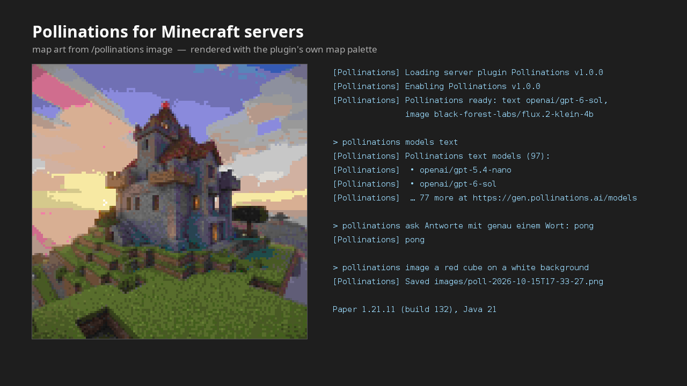

# Pollinations for Minecraft servers

[](https://pollinations.ai/?ref=badge)

Bring [Pollinations](https://pollinations.ai) to a Paper or Spigot server: villagers
that answer players, and prompts that become real in-game map art.



Built for the Pollinations [quest #17246](https://github.com/pollinations/pollinations/issues/17246).

## What it does

- **Villagers that chat.** Give a villager a name, walk up and talk in chat. It answers
  through a Pollinations text model, in character, and remembers the last few turns.
- **Map art from a prompt.** `/pollinations image <prompt>` turns a prompt into a
  filled map you can hang in an item frame.
- **Live model lists.** `/pollinations models` reads the current text and image models,
  so nobody has to guess an id.
- **One config file, or one command.** Store the API key in `config.yml` or set it in
  game with `/pollinations key <api-key>`.

Every request runs asynchronously, so a slow model never stalls the tick loop.

## Requirements

- A Paper or Spigot server for Minecraft 1.21 or newer
- Java 21 on the server
- A Pollinations API key: <https://enter.pollinations.ai/keys>

The key is required. Requests without one are rejected with `401`, and the plugin says
so in the console on startup.

## Install

1. Download `Pollinations-1.0.0.jar` from the
   [latest release](https://github.com/scalyxapp-jpg/pollinations-minecraft/releases/latest).
2. Drop it into your server's `plugins/` folder.
3. Restart the server. `plugins/Pollinations/config.yml` appears.
4. Put your API key in it, or run `/pollinations key <api-key>` in game.
5. Optional: set `text-model` and `image-model` to any id from
   `/pollinations models text` and `/pollinations models image`.

Nothing else is needed: the jar shades and relocates its only dependency, so it does
not touch the server's own libraries.

## Commands

| Command                              | What it does                                                                                     |
| ------------------------------------ | ------------------------------------------------------------------------------------------------ |
| `/pollinations ask <question>`       | Answer from the configured text model                                                            |
| `/pollinations image <prompt>`       | Generate an image, hand it to you as a filled map, and save it to `plugins/Pollinations/images/` |
| `/pollinations models [text\|image]` | List the live model ids                                                                          |
| `/pollinations reload`               | Re-read `config.yml`                                                                             |
| `/pollinations key <api-key>`        | Store a key without editing files (`-` clears it)                                                |

Aliases: `/poll`, `/polli`.

From the console, `ask`, `models`, `image` and `key` all work; the result of a console
run is written to the server log, because console command senders only see a
command's own output.

## Permissions

| Permission              | Default  | Covers               |
| ----------------------- | -------- | -------------------- |
| `pollinations.ask`      | everyone | `ask`                |
| `pollinations.villager` | everyone | talking to villagers |
| `pollinations.image`    | op       | `image`              |
| `pollinations.models`   | op       | `models`             |
| `pollinations.reload`   | op       | `reload`, `key`      |

## Configuration

```yaml
api-key: ""                                     # required, see above
text-model: "openai/gpt-6-sol"                  # any id from /pollinations models text
image-model: "black-forest-labs/flux.2-klein-4b"# any id from /pollinations models image
image-size: 512                                 # the API requires at least 256

villager-chat:
  enabled: true
  cooldown-seconds: 5
  radius: 6                                     # how close a player has to be
  prompt: "You are %name%, a villager in a Minecraft world. Answer the player in one short sentence."
  history-turns: 4                              # how much the villager remembers
request-timeout-seconds: 60
```

A map is 128x128 pixels, so the map is always rendered at that size; a larger
`image-size` only buys a sharper PNG in `plugins/Pollinations/images/`.

## Verified on a real server

Tested against Paper 1.21.11 (build 132) with Java 21, plugin version 1.0.0:

```
[Pollinations] Loading server plugin Pollinations v1.0.0
[Pollinations] Enabling Pollinations v1.0.0
[Pollinations] Pollinations ready: text openai/gpt-6-sol, image black-forest-labs/flux.2-klein-4b

> pollinations models text
[Pollinations] Pollinations text models (97):
[Pollinations]  • openai/gpt-5.4-nano
[Pollinations]  • openai/gpt-6-sol
...
[Pollinations]  … 77 more at https://gen.pollinations.ai/models

> pollinations ask Antworte mit genau einem Wort: pong
[Pollinations] pong

> pollinations image a red cube on a white background
[Pollinations] Saved images/poll-2026-10-15T17-33-27-813918148Z-a-red-cube-on-a-white-background.png
```

The saved file was a valid 512x512 RGB PNG. `mvn test` covers the map palette, which
is the one part with real arithmetic in it.

Two things the server told us that the docs do not:

- the image endpoint requires **at least 256 px per side** (a smaller request is
  rejected with `400`), and
- **unauthenticated requests are rejected with `401`**, so the anonymous tier is not
  an option here.

Both are handled: the size is clamped, and the missing key is reported at startup.

## Build from source

```bash
mvn package        # produces target/Pollinations-1.0.0.jar
mvn test           # map palette tests
```

## Behaviour notes

Villagers only talk when a player speaks within `villager-chat.radius` of them, at most
once per `cooldown-seconds` per player. Their persona is their name.

## License

MIT, see [LICENSE](LICENSE).
